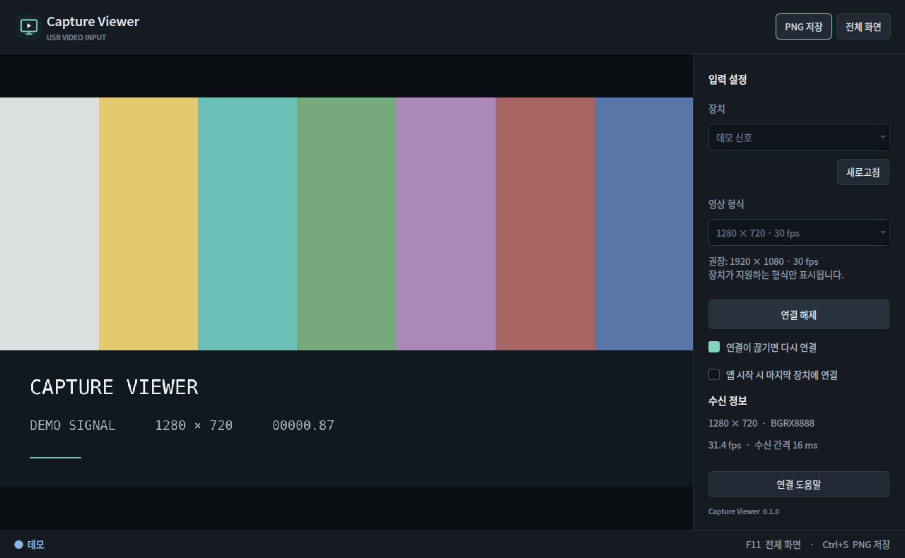

# Capture Viewer

[](https://github.com/YooJuno/capture_board_viewer/actions/workflows/build.yml)

USB HDMI 캡처보드의 영상을 보는 데스크톱 앱입니다. 장치·영상 형식 선택, 자동 재연결,
전체 화면, PNG 저장을 지원합니다.



## 다운로드

[Releases](https://github.com/YooJuno/capture_board_viewer/releases/latest)에서 OS와 CPU에 맞는 파일을 받으세요.
Python·별도 FFmpeg 설치 없이 실행합니다. UVC로 인식되는 캡처보드를 대상으로 합니다.

| OS | CPU | 파일 | 실행 |
|---|---|---|---|
| Windows 11 | x64 | `CaptureViewer-버전-windows-x64.zip` | 압축 해제 후 `CaptureViewer.exe` |
| macOS 15 이상 | Apple Silicon / Intel | `CaptureViewer-버전-macos-universal2.zip` | 압축 해제 후 앱을 응용 프로그램으로 이동 |
| Ubuntu 22.04 이상 | x64 | `CaptureViewer-버전-linux-x64.tar.gz` | `./CaptureViewer/CaptureViewer` |
| Ubuntu 24.04 이상 / Jetson Thor | ARM64 | `CaptureViewer-버전-linux-arm64.tar.gz` | `./CaptureViewer/CaptureViewer` |

초기 배포본은 코드 서명·Apple 공증을 포함하지 않습니다. macOS에서 차단되면 앱을 한 번 실행한 후
**시스템 설정 → 개인정보 보호 및 보안 → 그래도 열기**를 사용합니다. Windows 출처 확인 안내가 나오면
저장소와 릴리스 SHA-256을 확인한 뒤 실행하세요. 각 압축 파일의 `.sha256`을 함께 배포합니다.

## 사용 방법

1. 출력 장비 HDMI/DP → 캡처보드 **HDMI IN** → PC USB 순서로 연결합니다.
2. 입력 장치를 선택합니다. 예: `MACROSILICON USB3 Video`, `Cam Link`.
3. 영상 형식은 우선 **자동**으로 두고 **연결**을 누릅니다.
4. 끊김이 있으면 장치가 지원하는 1080p/30 fps 또는 720p 형식을 선택합니다.

| 기능 | 조작 |
|---|---|
| 전체 화면 | `F11` 또는 영상 더블클릭 |
| 전체 화면 종료 | `Esc` |
| 현재 프레임 PNG 저장 | `Ctrl+S` / macOS `⌘S` |
| 연결 / 연결 해제 | `Ctrl+Enter` |
| 새로고침 | `Ctrl+R` |

원래 영상 비율을 유지합니다. 자동 재연결은 **같은 장치 ID**만 기다리며 웹캠으로 바꾸지 않습니다.
기본값으로 앱을 열기만 해서는 장치에 연결하지 않습니다. 필요하면 **앱 시작 시 마지막 장치에 연결**을 켭니다.
장치·형식·창 크기·저장 폴더·재연결 설정은 사용자 계정에 저장합니다.

수신 정보는 실제 프레임 크기·형식과 최근 FPS를 표시합니다. `수신 간격`은 마지막 프레임 이후 경과 시간이며,
HDMI 출력부터 화면까지의 전체 지연 측정값이 아닙니다. 오디오 재생·녹음, 동영상 녹화, 네트워크 전송은 수행하지 않습니다.

## 운영체제별 설정

### Windows

**설정 → 개인정보 및 보안 → 카메라**에서 데스크톱 앱의 카메라 접근을 허용합니다.
배포본은 `_internal`을 포함한 전체 폴더를 유지하세요. EXE만 복사하면 실행되지 않습니다.

### macOS

최초 연결 시 카메라 접근을 허용합니다. 거절했다면 **시스템 설정 → 개인정보 보호 및 보안 → 카메라**에서 변경합니다.
앱의 `Info.plist`에 카메라 사용 목적을 포함합니다. 마이크 권한은 요청하지 않습니다.

### Linux / Jetson

일반 사용자 세션에서 실행합니다. `/dev/video*` 접근 권한과 UVC 장치 인식을 확인하세요.
화면 플러그인 라이브러리가 없으면 다음을 설치합니다.

```bash
sudo apt install libegl1 libopengl0 libxkbcommon-x11-0 libxcb-cursor0 \
  libxcb-icccm4 libxcb-keysyms1 libxcb-shape0 libxcb-xinerama0 libxcb-xkb1
```

소스 환경에서 앱 목록 바로가기를 추가하려면 `python scripts/install_linux.py`를 실행합니다.
소스 폴더와 `.venv`를 이동하지 마세요. 추출한 배포본은 `--bundle /절대경로/CaptureViewer`로 지정할 수 있습니다.

## 연결 문제

| 증상 | 확인 |
|---|---|
| 장치 목록에 없음 | USB 케이블·전원·OS 장치 인식. USB 허브 대신 직접 연결 |
| 열 수 없음 | OBS·카메라·ffplay 등 다른 앱의 점유, 카메라 권한 |
| 검은 영상 / 컬러바 | 출력 전원·해상도·HDMI IN 연결·DP→HDMI 변환기 |
| 끊김 | USB 대역폭, 지원 형식, 해상도·FPS 낮추기 |
| 재연결 반복 | 같은 장치 복구 여부. 연결 해제로 재시도 중단 |

`영상 수신 중`은 USB 프레임 수신을 뜻합니다. 일부 캡처보드는 HDMI 신호가 없어도 검은 영상이나 컬러바를 보냅니다.
일반 UVC 프레임만으로 HDMI 케이블 상태를 확정하지 않습니다.
**연결 도움말 → 로그 폴더**에서 크기 제한을 두고 순환 저장하는 `viewer.log`를 확인할 수 있습니다.

## 소스 실행

Python 3.11 이상이 필요합니다.

**Linux / macOS**

```bash
git clone https://github.com/YooJuno/capture_board_viewer.git
cd capture_board_viewer
python3 -m venv .venv
source .venv/bin/activate
python -m pip install -e .
capture-viewer
```

**Windows PowerShell**

```powershell
git clone https://github.com/YooJuno/capture_board_viewer.git
cd capture_board_viewer
py -3.11 -m venv .venv
.\.venv\Scripts\python.exe -m pip install -e .
.\.venv\Scripts\capture-viewer.exe
```

`python -m capture_viewer --demo`로 장치 없이 화면을 확인합니다. 데모는 장치를 열지 않습니다.
`--connect`는 마지막 선택 장치에 연결하며, `--version`으로 버전을 확인합니다.

## 개발·검증·자동 배포

```bash
python -m pip install -e '.[dev]'
python -m ruff check src tests scripts
python -m pytest -q
python scripts/build.py
python scripts/smoke_bundle.py
python scripts/package_release.py
```

빌드는 해당 OS에서 수행합니다. 실행 파일은 `dist/`, 배포 압축 파일과 SHA-256은 `release/`에 생성합니다.
PyInstaller 디렉터리 배포로 매 실행 시 임시 압축 해제를 피합니다.

GitHub Actions:

1. `main` push·PR·수동 실행: Windows·Linux x64·Linux ARM64·macOS universal2에서 검사 → 시험 → 빌드.
2. 생성한 실행 파일을 직접 실행해 데모 영상 렌더링·화면 저장·정상 종료 검사.
3. 압축 파일은 Actions Artifacts에서 다운로드.
4. 버전 태그 push 시 **4종 빌드 모두 성공 후** GitHub Release에 업로드.

```bash
git tag v0.1.0
git push origin v0.1.0
```

태그는 `pyproject.toml`, `capture_viewer.__version__`, macOS 앱 버전과 일치시킵니다.
자동 시험은 장치 분리·점유 오류·재시도 취소·이전 콜백·최신 프레임 유지·전체 화면·PNG 저장을 검사합니다.
CI에는 물리 캡처보드가 없으므로 실제 장치 호환성과 전체 영상 지연은 각 OS에서 별도로 확인해야 합니다.
macOS는 Intel 러너에서 universal2 앱을 빌드·실행하고, 모든 Mach-O 바이너리의
Intel·Apple Silicon 슬라이스를 검사합니다. Apple Silicon 실기에서의 실행은 별도 확인 대상입니다.

## 코드 구성

| 경로 | 역할 |
|---|---|
| `src/capture_viewer/app.py` | 실행 인자·로그·앱 초기화 |
| `window.py`, `canvas.py` | 창·영상 표시·PNG 저장 |
| `controller.py`, `modes.py` | 캡처 수명·재연결·지원 형식 |
| `demo.py` | 하드웨어 없는 시험 신호 |
| `packaging/`, `scripts/` | OS별 리소스·빌드·압축·배포본 검증 |
| `tests/`, `.github/workflows/` | 자동 시험·OS별 빌드·릴리스 |

PySide6 / Qt Multimedia를 사용합니다. 캡처 콜백은 최신 프레임 하나만 교체하고 UI는 최대 약 60Hz로 표시합니다.
프레임 대기열을 누적하거나 별도 ffplay 창을 실행하지 않습니다. 실제 표시 비용과 지연은 장비에 따라 달라집니다.
외부 구성 요소 정보는 [THIRD_PARTY.md](THIRD_PARTY.md)를 참고하세요.
